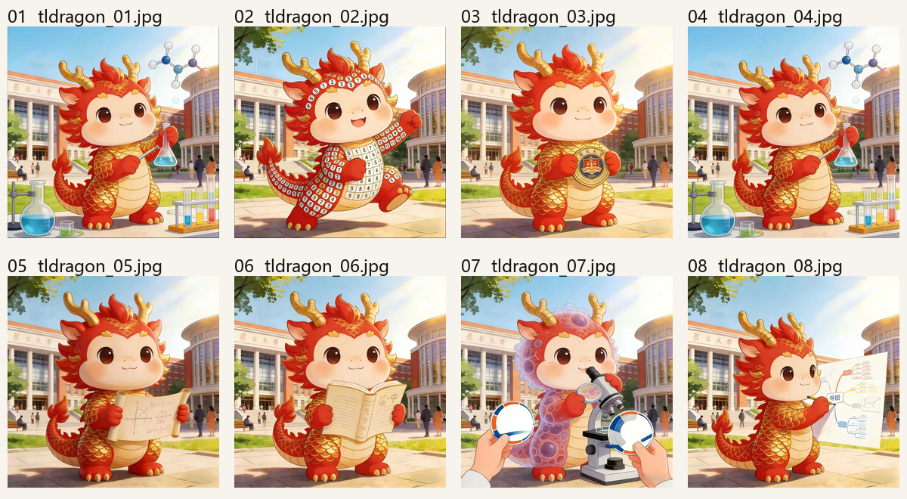
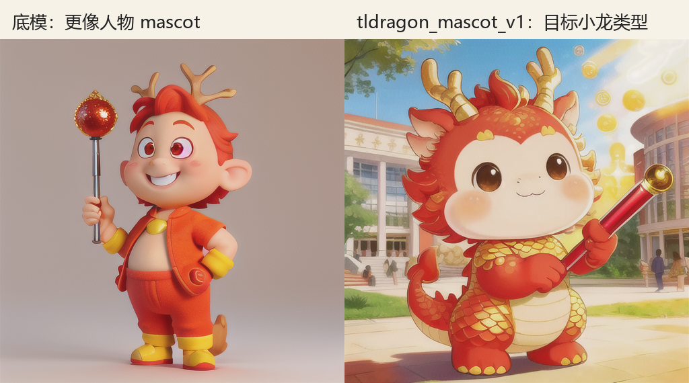
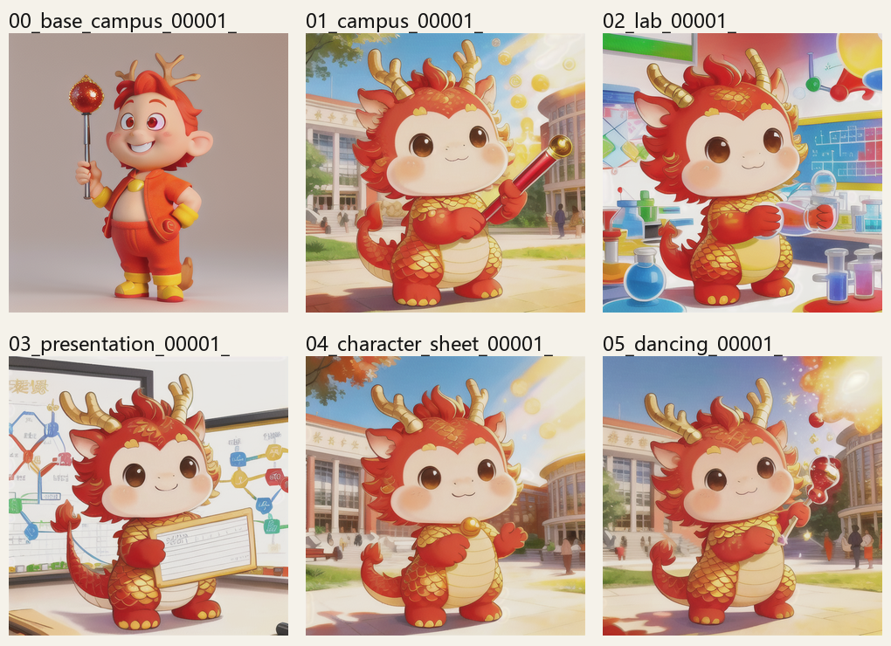

# Lora-Training-in-Comfy

## ComfyUI 内直接训练 SD1.x / SD2.x LoRA

这是 [LarryJane491/Lora-Training-in-Comfy](https://github.com/LarryJane491/Lora-Training-in-Comfy) 的兼容性维护分支，重点修复旧版训练脚本在当前 ComfyUI 环境中的兼容问题。

> **适用范围：SD1.x / SD2.x**
>
> 当前节点调用仓库内的 `sd-scripts/train_network.py`，适用于 SD1.5、SD2.x，以及基于 SD1/SD2 架构的 SD Turbo、LCM 等模型。
>
> 不支持 SDXL、SD3.5、FLUX、Qwen-Image、LTX、Wan 等新架构。训练出的 LoRA 也只能用于与训练底模相同架构的模型。

## 小龙案例

下面是用本仓库节点在 ComfyUI 内直接训练出的 `tldragon_mascot_v1` 案例，底模为 SD1.5 系列的 `2.5D_disneyPixarCartoon_v10`，触发词为 `tldragon`。

### 训练集

10 张原始图中去掉 2 张近重复图，实际使用 8 张唯一图，每张有独立 caption。



### 训练前后

同一提示词、同一种子、同一采样器，底模与 LoRA 的对比：



### 多场景生成

校园、实验室、汇报、角色设定和跳舞场景：



案例工作流：

- [训练工作流](examples/tldragon/01_train_lora.json)
- [生成工作流](examples/tldragon/02_generate.json)

## 已适配环境

本分支已在以下环境实际完成训练与生成验证：

| 组件 | 版本 |
|---|---|
| ComfyUI | 0.37.0 |
| Python | 3.12.12 |
| PyTorch | 2.10.0+cu128 |
| transformers | 5.2.0 |
| diffusers | 0.37.0 |
| accelerate | 1.12.0 |
| xformers | 0.0.35 |
| bitsandbytes | 0.49.2 |
| GPU | NVIDIA RTX 3090 24 GB |

## 兼容修复内容

1. `transformers >= 5` 移除 `CLIPFeatureExtractor` 后，使用 `CLIPImageProcessor` 兼容回退。
2. 加载新版 CLIP 时移除不再接受的 `text_model.embeddings.position_ids`。
3. 固定调用本节点自带的 `sd-scripts/train_network.py`，避免机器上存在多个同名目录时选错脚本。
4. 使用节点目录内缓存的 CLIP tokenizer，并启用离线模式，避免训练时卡在网络请求。
5. 使用当前 ComfyUI 的 Python 解释器启动 `accelerate`。
6. 训练子进程使用 `check=True`，训练失败会正确向上报错，不再静默显示成功。
7. 修复随机种子表达式的位运算写法。

完整补丁位于：

```text
patches/lora-training-in-comfy_compat.patch
```

历史兼容快照位于：

```text
patches/lora-training-in-comfy_python312_torch210.patch
```

## 安装

### 1. 放入 ComfyUI

在 ComfyUI 的 `custom_nodes` 目录中执行：

```bash
cd /path/to/ComfyUI/custom_nodes
git clone git@github.com:IammyselfYBX/Lora-Training-in-Comfy.git
```

已有安装则更新：

```bash
cd /path/to/ComfyUI/custom_nodes/Lora-Training-in-Comfy
git pull
```

### 2. 依赖

当前 ComfyUI 环境通常已经包含训练所需的大部分依赖。**不要直接执行旧的 `requirements.txt`**，因为它包含较老的版本锁定，可能降级 ComfyUI 共享环境。

先确认以下模块可以导入：

```bash
python - <<'PY'
import torch, accelerate, transformers, diffusers, pytorch_lightning
import safetensors, xformers, bitsandbytes
print('dependencies ok')
PY
```

如果只缺少个别包，再使用 ComfyUI 当前 Python 环境单独安装，例如：

```bash
python -m pip install tensorboard toml einops ftfy open-clip-torch
```

### 3. 重启 ComfyUI

重启 ComfyUI 后，在节点搜索中查找：

```text
Lora Training in ComfyUI
Lora Training in ComfyUI (Advanced)
```

节点分类：

```text
LJRE/LORA
```

## 数据集格式

训练目录必须按 `数字_概念名` 命名：

```text
training_data/
└── 10_tldragon_mascot/
    ├── image_01.jpg
    ├── image_01.txt
    ├── image_02.jpg
    └── image_02.txt
```

节点中的 `data_path` 要填写**包含该子目录的父目录**，不是图片目录本身。

caption 建议第一条固定写触发词：

```text
tldragon, chibi red-orange baby dragon mascot, glossy scales, cream belly, golden antlers, 3D cartoon render
```

## 小龙案例参数

| 参数 | 值 |
|---|---|
| 底模 | `SD1.5/2.5D/2.5D_disneyPixarCartoon_v10.safetensors` |
| 数据目录 | `10_tldragon_mascot` |
| 图片数 | 8 张唯一图 |
| 每张重复 | 10 次 |
| Epochs | 10 |
| 总步数 | 800 |
| Batch size | 1 |
| 分辨率 | 512×512 |
| 网络 | LoRA rank 32 / alpha 32 |
| 优化器 | AdamW8bit |
| 精度 | fp16 |
| 输出 | `models/loras/tldragon_mascot_v1.safetensors` |

推荐生成强度：

```text
strength_model = 0.88
strength_clip  = 0.78
```

推荐提示词：

```text
tldragon, cute chibi red-orange baby dragon mascot, oversized head, small body, glossy red scales, cream belly, golden antlers, big sparkling eyes, cheerful smile, 3D cartoon render, Pixar style, soft lighting, vibrant colors, [scene], [action], [prop]
```

## 使用流程

1. 在 ComfyUI 中打开训练工作流。
2. 确认 `data_path` 指向数据集父目录。
3. 运行训练，等待日志出现 `model saved`。
4. 刷新 LoRA 列表。
5. 打开生成工作流，修改 `[scene]`、`[action]`、`[prop]` 对应的场景描述。
6. 一次生成多张，选择最稳定的 LoRA 强度和种子。

## 适用与不适用场景

### 适用

- SD1.5 角色、人物、画风 LoRA
- SD2.x LoRA
- 基于 SD1/SD2 的 Turbo、LCM 衍生底模
- 8–40 张左右的小样本角色或风格训练
- 在 ComfyUI 内完成数据准备、训练和即时测试

### 不适用

- SDXL LoRA
- SD3.5 LoRA
- FLUX LoRA
- Qwen-Image、LTX、Wan 等新架构
- 视频模型或非 Stable Diffusion 扩散模型

仓库虽然包含 `sdxl_train_network.py`，但当前 ComfyUI 节点没有接入 SDXL 训练路径。

## 仓库结构

```text
Lora-Training-in-Comfy/
├── examples/tldragon/       # 小龙案例、工作流和结果图
├── patches/                 # 当前兼容补丁和历史快照
├── sd-scripts/              # 内置训练脚本
├── train.py                 # ComfyUI 节点实现
├── __init__.py
└── README.md
```

## 上游项目

- 上游仓库：<https://github.com/LarryJane491/Lora-Training-in-Comfy>
- 原教程：<https://www.reddit.com/r/StableDiffusion/comments/193hqkz/lora_training_directly_in_comfyui/>

本分支保留上游节点的基本使用方式，只在兼容性、错误处理和示例文档上做维护。
